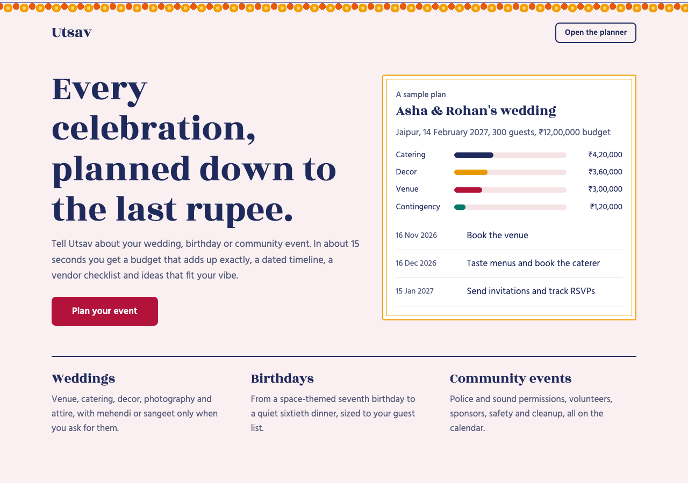
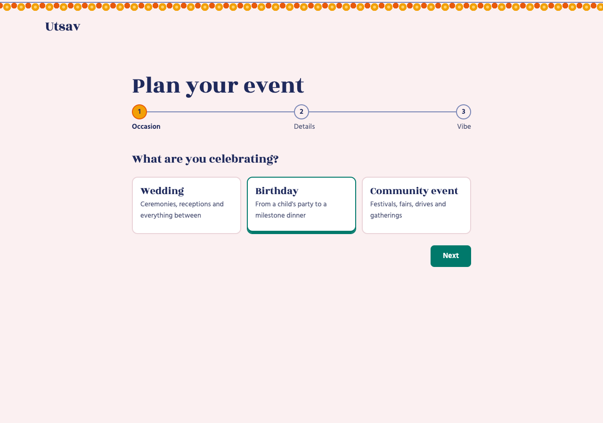
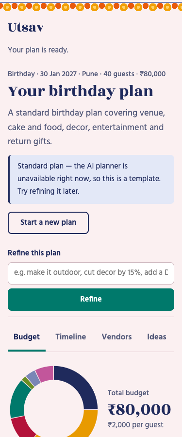

# Utsav — GenAI event planner

**Plan weddings, birthdays and community events in minutes: an exact budget, a dated timeline, a vendor checklist and ideas made for your event.**

[](https://utsav-823065407403.asia-south1.run.app)


**Live app:** https://utsav-823065407403.asia-south1.run.app

Built for **PromptWar 5** (Google × Hack2skill).



| Wizard | Plan on mobile |
|---|---|
|  |  |

---

## Contents

- [The problem](#the-problem)
- [Features](#features)
- [How it works](#how-it-works)
- [Architecture](#architecture)
- [Tech stack](#tech-stack)
- [Getting started](#getting-started)
- [Configuration](#configuration)
- [API](#api)
- [Testing](#testing)
- [Deploying to Cloud Run](#deploying-to-cloud-run)
- [Security](#security)
- [Mapping to the judging criteria](#mapping-to-the-judging-criteria)
- [Project layout](#project-layout)

## The problem

Planning an Indian wedding, a child's birthday or a neighbourhood festival means juggling a budget, dozens of deadlines, many vendors and a lot of advice. Generic checklists ignore your budget, guest count, city and style. Chatbots give you a nice paragraph, but their numbers rarely add up and they don't give you dates you can act on.

Utsav asks three short questions and returns a plan you can actually run. The amounts add up to your budget to the rupee, every task has a real date, and the plan stays editable, saveable and trackable until the event.

## Features

| | Feature | What you get |
|---|---|---|
| 🧭 | **3-step wizard** | Event type (wedding, birthday, community), date, city, guest count, budget (INR), up to 5 vibes (traditional, modern, eco, grand…) and free-text notes |
| 💰 | **Exact budget** | Category lines that always add up to your total, a contingency of at least 5 % and a per-guest warning when the budget is tight |
| 🗓️ | **Dated timeline** | Every task has a real due date counted back from the event in IST. Overdue tasks move to today and are flagged. |
| 🧾 | **Vendor checklist** | The vendor roles you need, when to book them and the questions to ask each one |
| ✨ | **Personalised ideas** | Themes, decor, food, activities and return favours that fit your event, vibe and budget |
| 💬 | **Refine in plain language** | "Make it outdoor, cut decor by 15 %". Your ticked tasks and logged spending carry over. |
| 🔐 | **Accounts** | Email/password or Google sign-in (Firebase Auth). Save plans and come back to them under **My events**. |
| ✅ | **Progress & spend tracking** | Tick off tasks, log what you spend and compare planned with actual spending per category |
| 📍 | **Real local vendors** | Gemini with **Google Search grounding** finds vendors in your city, with source links taken only from grounding metadata. Results are cached for 24 h on saved events. |
| 📸 | **Photo → ideas** | Upload an inspiration photo (JPEG/PNG/WebP, up to 5 MB) and Gemini vision turns it into decor ideas with a colour palette |
| 📆 | **Calendar export** | Download the timeline as an `.ics` file for Google Calendar, Apple Calendar or Outlook |
| 🛟 | **Works when the AI is down** | If Gemini fails, you get a built-in standard plan with a banner instead of a blank page |

## How it works

**Gemini suggests, plain Python calculates.**

1. The wizard sends your answers to `POST /api/plans/generate`.
2. Gemini (structured output, JSON schema) returns a plan **skeleton**: weighted budget categories, tasks phrased as "N days before the event", vendor roles with questions to ask, and ideas.
3. `planning/sanitize.py` clamps and cleans the skeleton. Nothing from the model is trusted as-is.
4. Pure, property-tested functions turn the skeleton into the final plan:
   - `budget.py`: largest-remainder rounding, so whole-rupee lines **always sum exactly** to your total
   - `timeline.py`: real due dates in IST; overdue tasks move to today and are flagged
   - `assemble.py`: combines everything with your progress (ticked tasks, logged spending)
5. When you refine, Gemini edits the existing skeleton and task ids stay the same, so your progress carries over.

## Architecture

```
Browser ─ index.html · app.html (wizard, dashboard, sign-in dialog) · Firebase JS SDK
   │  fetch /api/*   (Authorization: Bearer <Firebase ID token> when signed in)
   ▼
FastAPI on Cloud Run (asia-south1)
   ├─ routes/       plans (open, rate-limited) · events (signed-in, scoped per uid) · meta
   ├─ ai/           client.py: the only Gemini caller (retry → fallback model → JSON repair)
   │                prompts.py: user text only inside a <user_data> block · service.py
   ├─ planning/     PURE: sanitize · budget · timeline · tracking · ics · defaults · assemble
   ├─ auth.py       Firebase ID-token verification (uid always from the token)
   └─ store.py      Firestore planner_users/{uid}/events/{id}  (in-memory store for tests)
Google Cloud: Vertex AI Gemini (service-account auth) · Firebase Auth · Firestore · Cloud Logging
```

The frontend is plain HTML, CSS and ES modules, with no build step. `app/ai/client.py` is the only module that calls Gemini. It retries transient errors, falls back from `gemini-3.5-flash` to `gemini-2.5-flash`, and repairs malformed JSON.

## Tech stack

| Layer | Technology |
|---|---|
| Backend | Python 3.12, FastAPI, Pydantic v2, Uvicorn |
| AI | Google Gen AI SDK → **Vertex AI Gemini 3.5 Flash** (structured output, Google Search grounding, vision), 2.5 Flash fallback |
| Auth | Firebase Authentication (email/password, Google) with server-side ID-token verification via `firebase-admin` |
| Data | Cloud Firestore (production); an in-memory store for local runs and tests |
| Frontend | Vanilla JS ES modules, hand-written CSS, Firebase JS SDK |
| Hosting | Cloud Run (asia-south1), container built by Cloud Build |
| Observability | Structured JSON request logs → Cloud Logging |
| Testing | pytest, hypothesis (property tests), pytest-cov, httpx |

## Getting started

### Prerequisites

- Python **3.12**
- Optional, for real AI output: a Google Cloud project with the Vertex AI API enabled, and `gcloud auth application-default login`

### Run locally

```bash
git clone https://github.com/ojha-436/Utsav.git
cd Utsav
python3.12 -m venv .venv && .venv/bin/pip install -r requirements-dev.txt

# No AI and no cloud: built-in standard plans, in-memory store
STORE=memory .venv/bin/uvicorn app.main:app --reload

# Real Gemini through Vertex AI using your gcloud login
STORE=memory USE_VERTEXAI=true GCP_PROJECT=<your-project> .venv/bin/uvicorn app.main:app --reload
```

Open http://127.0.0.1:8000/app.

## Configuration

All settings are environment variables (see [`app/config.py`](app/config.py) and [`.env.example`](.env.example)).

| Variable | Default | Purpose |
|---|---|---|
| `USE_VERTEXAI` | `false` | `true` uses Vertex AI with the runtime service account (no API key) |
| `GCP_PROJECT` | — | Google Cloud project for Vertex AI and Firestore |
| `GEMINI_LOCATION` | `global` | Vertex AI location |
| `GEMINI_MODEL` | `gemini-3.5-flash` | Primary model |
| `GEMINI_FALLBACK_MODEL` | `gemini-2.5-flash` | Used when the primary model fails |
| `GEMINI_API_KEY` | — | Only for the Gemini Developer API (`USE_VERTEXAI=false`) |
| `STORE` | `memory` | `memory` (local, tests) or `firestore` (production) |
| `FIREBASE_API_KEY` | — | Firebase **web** API key (public by design) |
| `FIREBASE_AUTH_DOMAIN` | — | e.g. `<project>.firebaseapp.com` |
| `MAX_BODY_BYTES` | `6000000` | Request body limit |

Without Firebase settings the app still plans, refines and exports to a calendar. Only sign-in, saving and tracking need Firebase.

## API

All errors use one shape: `{"error": {"code": "...", "message": "..."}}`.

| Method | Path | Auth | Description |
|---|---|---|---|
| `GET` | `/api/healthz` | — | Liveness check |
| `GET` | `/api/config` | — | Public Firebase web config for the frontend |
| `POST` | `/api/plans/generate` | — | Wizard input → full plan (rate-limited) |
| `POST` | `/api/plans/refine` | — | Current plan + instruction → refined plan |
| `POST` | `/api/calendar.ics` | — | Plan → downloadable `.ics` |
| `POST` | `/api/vendors` | optional | Grounded local vendor search (cached on saved events) |
| `GET` | `/api/events` | ✔ | List my saved events |
| `POST` | `/api/events` | ✔ | Save a plan |
| `GET` | `/api/events/{id}` | ✔ | Load a saved event |
| `PUT` | `/api/events/{id}` | ✔ | Replace a saved plan (e.g. after refining) |
| `DELETE` | `/api/events/{id}` | ✔ | Delete an event |
| `PATCH` | `/api/events/{id}/tasks/{task_id}` | ✔ | Tick or untick a task |
| `POST` | `/api/events/{id}/spend` | ✔ | Log spending |
| `DELETE` | `/api/events/{id}/spend/{entry_id}` | ✔ | Remove a spend entry |
| `POST` | `/api/events/{id}/photo-ideas` | ✔ | Upload an inspiration photo → ideas |

✔ = `Authorization: Bearer <Firebase ID token>`. Another user's event returns `404`.

## Testing

```bash
.venv/bin/pytest                                     # 160 tests, about 2 s, no network
.venv/bin/pytest --cov=app/planning --cov=app/routes --cov-report=term-missing --cov-fail-under=85
```

- **No network or cloud needed.** The tests use a fake Gemini client, the in-memory store and a fake token verifier.
- **Property tests** (hypothesis) prove that budget lines always sum exactly to the total, for any budget and weights.
- **Coverage:** 97 % on `planning/` + `routes/`, 94 % overall.
- Covered: the RFC 5545 calendar output (escaping, 75-octet folding of Devanagari), auth scoping, rate limits, body limits, image sniffing, AI retry and fallback, JSON repair, and a static check that the UI never puts model text into `innerHTML`.

## Deploying to Cloud Run

```bash
gcloud run deploy utsav --source . --region asia-south1 --allow-unauthenticated \
  --max-instances 3 --memory 512Mi \
  --set-env-vars USE_VERTEXAI=true,GEMINI_LOCATION=global,GEMINI_MODEL=gemini-3.5-flash,GEMINI_FALLBACK_MODEL=gemini-2.5-flash,GCP_PROJECT=<project>,STORE=firestore,FIREBASE_AUTH_DOMAIN=<project>.firebaseapp.com,FIREBASE_API_KEY=<public web api key>
```

- The runtime service account needs `roles/aiplatform.user` and `roles/datastore.user`.
- In the Firebase console, enable the Email/Password and Google sign-in providers.
- For "Continue with Google", add the Cloud Run hostname under **Firebase Authentication → Settings → Authorized domains**.
- `firestore.rules` denies all browser access. Deploy it as-is only in a project used only by Utsav.

## Security

- **No API keys in the app.** Gemini is called through Vertex AI with the Cloud Run service account.
- **Server-side auth.** Firebase ID tokens are verified on the server, the uid always comes from the token, and asking for another user's event returns `404`.
- **Firestore is server-only.** The rules deny all browser access, and the backend uses the Admin SDK.
- **Prompt-injection containment.** User text goes into the prompt only inside a JSON-escaped `<user_data>` block, output is constrained by a schema, and everything is sanitised before use.
- **Safe rendering.** Model text is rendered with `textContent` only, and a test enforces this.
- **HTTP hardening.** Strict CSP, `frame-ancestors 'none'`, `nosniff` and a strict referrer policy.
- **Abuse limits.** AI endpoints are limited to 10 requests/min per IP and photo uploads to 5/min per user. Requests are capped at 6 MB and images at 5 MB, and images are checked by magic bytes.
- **Privacy.** Logs never contain user text. The container runs as a non-root user.

## Mapping to the judging criteria

| Criterion | Evidence |
|---|---|
| **Code quality** | Small single-purpose modules; a pure `planning/` core with no I/O; typed Pydantic models at every boundary; one Gemini doorway (`ai/client.py`); thin routes; one error shape everywhere. |
| **Problem alignment** | All three event types × all four outputs (budget, timeline, vendor checklist, personalised ideas), plus refine, saving, tracking, calendar, grounded vendors and photo ideas. Event-specific guidance (for example, police, municipal and sound permissions for community events). INR throughout. |
| **Security** | See [Security](#security): server-side token verification, no API keys, server-only Firestore, prompt-injection containment, CSP, rate and size limits, non-root container. |
| **Testing** | 160 pytest tests with no network; hypothesis property tests; 97 % coverage on `planning/` + `routes/`, 94 % overall; headless-browser checks of the wizard, keyboard tabs, mobile layout, sign-in, saving and tracking. |
| **Google Cloud** | Cloud Run · Vertex AI Gemini 3.5 Flash (structured output, Google Search grounding, vision) with 2.5 Flash fallback · Firebase Authentication · Firestore · Cloud Build · Cloud Logging. |

## Project layout

```
app/
  main.py          app factory, security headers, body limit, request logging
  config.py        settings from environment variables
  auth.py          Firebase ID-token verification
  store.py         Firestore and in-memory event stores
  models.py        Pydantic request/response models
  ai/              client.py (Gemini), prompts.py, service.py
  planning/        pure logic: sanitize, budget, timeline, tracking, ics, defaults, assemble
  routes/          plans.py, events.py, meta.py
static/            index.html, app.html, css/app.css, js/*.js (ES modules, no build step)
tests/             pytest suite: factories.py, fakes.py, test_*.py
docs/
  screenshots/     README images
  superpowers/     design spec and implementation plan
Dockerfile         python:3.12-slim, non-root user
firestore.rules    deny all client access
```
